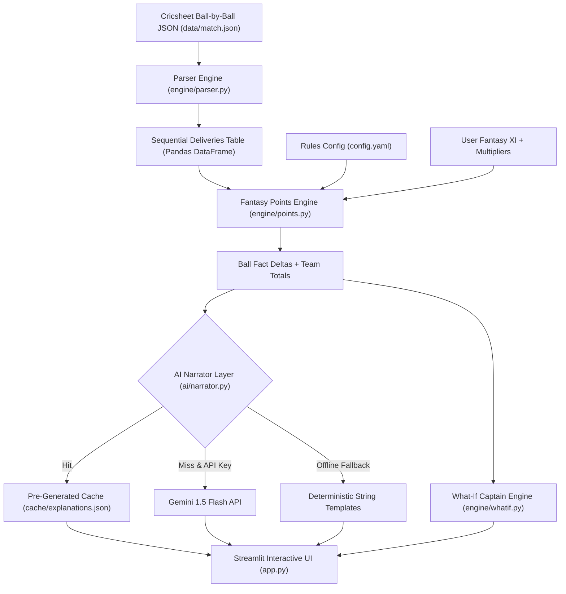

# 🏏 Match Companion — Dream11 Live AI Assistant

> **Deterministic Fantasy Cricket Engine with Contextual AI Commentary**  
> Built for the Dream11 Forward Deployed Engineer Intern Assignment.

---

## ⚡ The Fan Problem

Fantasy sports fans tracking live matches frequently see their points jump or drop without understanding the exact scoring breakdown or rules applied. Furthermore, fans joining mid-match often feel disoriented about what happened in missed overs and how their fantasy players contributed.

---

## 🚀 Live Demo & "Try This First"

- **Recommended First Action**:
  1. Use the **Match Progress Slider** (or click the quick jump **"⚡ Wicket"** button in the sidebar) to navigate to **Ball 21**.
  2. Open the **"⚡ Explain My Points"** tab: see Vice-Captain Jasprit Bumrah's clean bowled dismissal of Quinton de Kock (+49.5 pts with 1.5x boost) explained instantly in English or Hinglish.
  3. Slide to **Ball 35** (or click **"🏆 Finish"**): witness Hardik Pandya's wicket and Suryakumar Yadav's iconic World Cup-winning boundary catch (+8 fielding pts).
  4. Switch to the **"👑 What-If Captain"** tab to see how selecting Bumrah as Captain would have altered your total score!
  5. Toggle the language in the sidebar between **English** and **Hinglish** for authentic couch-commentary vibes.

---

## 🏗️ Architecture & Core Design Principle

Our key architectural differentiator is strict separation of concerns:
- **Deterministic Math Engine**: All point calculations, boundary bonuses, milestone checks, multipliers, and what-if differentials are computed using pure, deterministic Python code based on official Dream11 T20 rules.
- **AI Narration Layer**: The LLM (Gemini 1.5 Flash) and pre-generated cache **strictly narrate** structured facts. The AI never calculates scores or predicts outcomes, eliminating numerical hallucinations and upholding Dream11's responsible-play ethos.



```text
Cricsheet JSON  ──>  engine/parser.py  ──>  Deliveries DataFrame
                                                    │
                 config.yaml rules  ───────────────>│
                 User Fantasy XI    ───────────────>│
                                                    ▼
                                           engine/points.py
                                           (Deterministic Math)
                                                    │
                             ┌──────────────────────┴──────────────────────┐
                             ▼                                             ▼
                     Structured Facts                               engine/whatif.py
                             │                                     (Alternate Captains)
                             ▼                                             │
                      ai/narrator.py                                       │
            (Cache ──> Gemini ──> Fallback)                                │
                             │                                             │
                             └──────────────────────┬──────────────────────┘
                                                    ▼
                                            Streamlit Dashboard
                                            (Catch-Up | Explain | What-If)
```

---

## 🌟 Key Features

1. **📖 Catch Me Up Tab**:
   - 3–4 bullet recap for fans joining mid-game.
   - Highlights the user's active fantasy players first, along with match phase status and key boundary/wicket moments.
2. **⚡ Explain My Points Tab**:
   - Reverse-chronological timeline of deliveries with instant one-line explanations under 20 words.
   - Distinct green badges for point earnings and red badges for point deductions (duck penalties).
   - Filter to show only events scoring for the user's active fantasy XI or all match events.
3. **👑 What-If Captain Tab**:
   - Evaluates alternative captain choices (2.0x multiplier) from the squad.
   - Dynamic callout revealing the optimal captain choice up to the current delivery.
4. **🌐 Dual Language Support (English / Hinglish)**:
   - English: Sharp, professional cricket commentary.
   - Hinglish: Natural Indian Romanized cricket slang ("*Bumrah ne clean bowled kiya!*").
5. **🛡️ 100% Offline & Resilience Guarantee**:
   - Pre-generated cache (`cache/explanations.json`) ensures 0ms latency and 100% uptime even without an internet connection or API key.
   - Automatic fallback to high-precision deterministic templates if API quota is reached.

---

## 📋 Dream11 Scoring System Modeled (T20 Format)

| Event | Base Points | Notes |
| :--- | :--- | :--- |
| **Run Scored** | +1 pt | Applied per run |
| **Boundary Four Bonus** | +1 pt | 4 runs + 1 bonus = 5 pts |
| **Six Bonus** | +2 pts | 6 runs + 2 bonus = 8 pts |
| **Duck Penalty** | -2 pts | Batsman dismissed for 0 runs |
| **Wicket (Excl. Run Out)** | +25 pts | Credited to bowler |
| **Bowled / LBW Bonus** | +8 pts | 25 base + 8 bonus = 33 pts |
| **Dot Ball** | +1 pt | Bowler conceding 0 runs on legal delivery |
| **Maiden Over Bonus** | +12 pts | 0 runs conceded in a full 6-ball over |
| **Catch Dismissal** | +8 pts | Credited to fielder |
| **Stumping** | +12 pts | Credited to wicket-keeper |
| **Direct Run Out** | +12 pts | Credited to fielder |
| **Captain Armband** | **2.0x** | Doubles all fantasy points earned |
| **Vice-Captain Armband**| **1.5x** | 1.5x multiplier on all fantasy points |

---

## 🛠️ Local Setup & Running Instructions

### 1. Clone Repository & Install Dependencies
```bash
cd match-companion
pip install -r requirements.txt
```

### 2. Run Test Suite
```bash
python -m pytest tests
```
*All 12 unit tests verify deterministic runs, boundary bonuses, wickets, duck penalties, fielding catches, what-if math, and narrator resilience.*

### 3. Launch Streamlit Application
```bash
streamlit run app.py
```
*The app opens automatically in your browser at `http://localhost:8501`.*

### 4. (Optional) Set Gemini API Key
If you wish to use live LLM narration instead of the pre-generated cache, set the environment variable or enter it directly in the app's sidebar:
```bash
export GEMINI_API_KEY="your-api-key"   # Linux/macOS
$env:GEMINI_API_KEY="your-api-key"    # Windows PowerShell
```

---

## 📂 Repository Structure

```text
match-companion/
├── app.py                # Streamlit UI with 3 tabs, slider, and responsive styling
├── config.yaml           # Dream11 T20 scoring rules, fantasy XI team roster
├── requirements.txt      # Python dependencies
├── generate_cache.py     # Offline cache generator for instant demo responses
├── README.md             # Project documentation and architecture guide
├── SUBMISSION_NOTE.md    # 200-word executive summary for assignment submission
├── ai/
│   ├── __init__.py
│   ├── narrator.py       # Narration engine with Cache -> Gemini -> Fallback
│   └── prompts.py        # System instructions and prompt templates
├── cache/
│   └── explanations.json # Pre-generated English and Hinglish commentary (92 events)
├── data/
│   └── match.json        # 2024 ICC T20 World Cup Final ball-by-ball Cricsheet data
├── engine/
│   ├── __init__.py
│   ├── parser.py         # Cricsheet JSON parser to DataFrame
│   ├── points.py         # Deterministic fantasy points calculator
│   └── whatif.py         # Alternate captain mathematical comparison
└── tests/
    ├── __init__.py
    ├── test_narrator.py  # AI narrator and template fallback tests
    └── test_points.py    # Fantasy scoring and what-if unit tests
```

---

## ⚠️ Limitations & Future Work

1. **Live Feed Ingestion**: Currently replays historical Cricsheet ball-by-ball JSON. In production, connect to WebSocket feeds (Sportradar or Cricinfo live push) for real-time streaming.
2. **Dynamic Squad Selection**: The demo features a pre-configured 11-player fantasy team from the 2024 T20 World Cup Final. In a live app, allow fans to import their active Dream11 contest lineup via user ID or contest link.
3. **Multi-Contest Leaderboards**: Show rank progression and peer comparisons alongside point explanations.

---

## 📜 Disclaimer
This demo deterministically replays past match events for educational and fan engagement purposes. It does not provide betting advice, odds calculation, or predictive gambling services.

